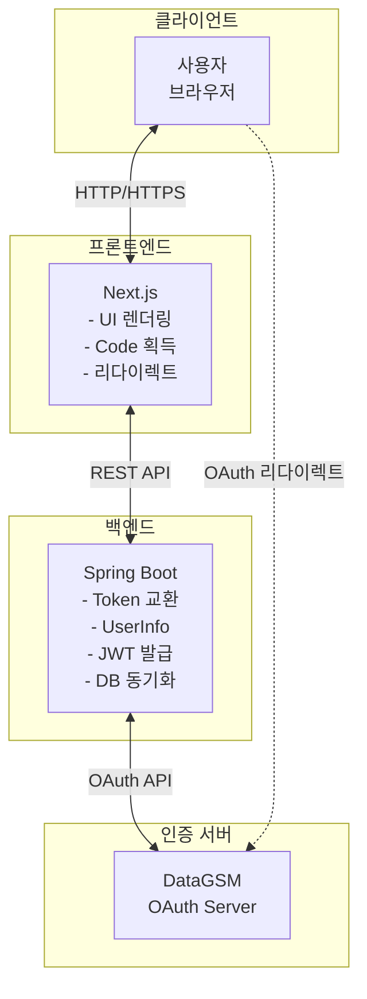
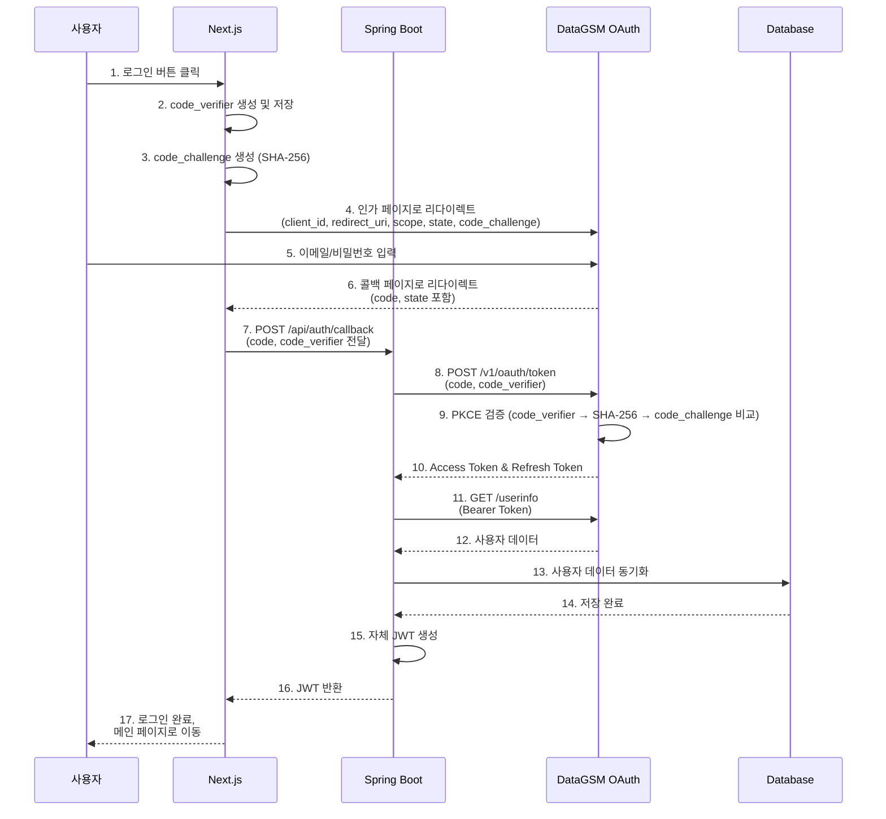
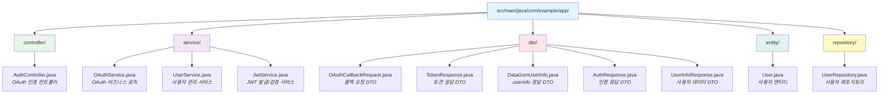
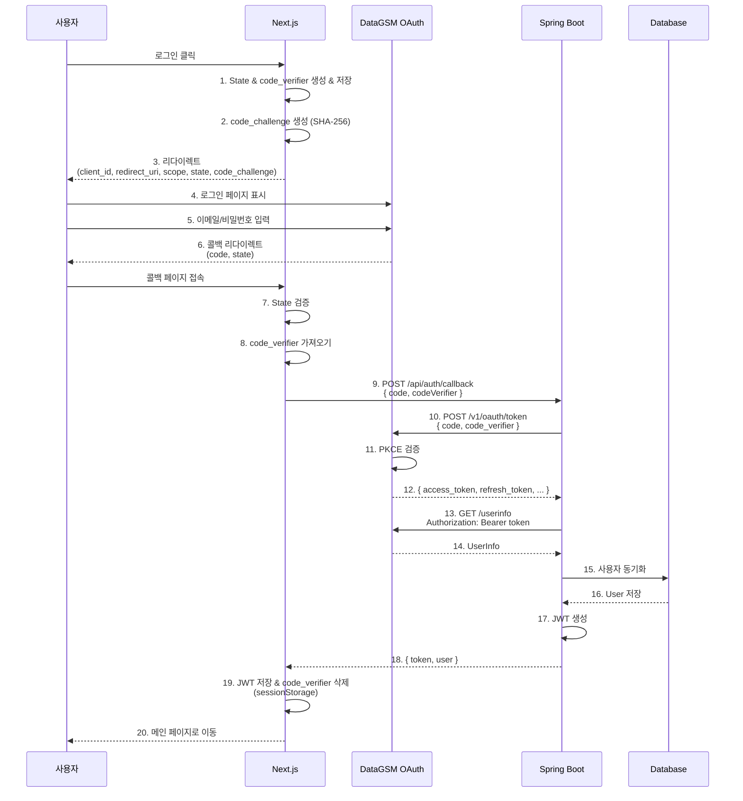

import { createDocsPageMetadata } from '@/shared/lib/metadata';

export const metadata = createDocsPageMetadata({ title: "Next.js + Spring Boot", pathname: "/oauth/examples/nextjs-spring-boot" })

# Next.js + Spring Boot OAuth 구현

### 시나리오

프론트엔드(Next.js)에서 Authorization Code까지 획득하고, 서버(Spring Boot)에서 PKCE 검증 및 Token 교환, 사용자 데이터 조회 후 자체 JWT 발급하는 완전한 OAuth 구현 예제입니다.

이 방식은 PKCE를 사용하여 Authorization Code 탈취를 방지하면서 서버 측에서 사용자 인증을 완전히 제어할 수 있는 안전한 구현 방식입니다.

## 아키텍처 개요

### 시스템 구성도



### 데이터 플로우

전체 인증 프로세스는 다음 순서로 진행됩니다.



### 책임 분리

각 레이어의 명확한 책임 분리로 보안과 유지보수성을 확보합니다.

#### 프론트엔드 (Next.js)

| 책임 | 설명 |
| --- | --- |
| **UI 렌더링** | 로그인 페이지, 로딩 상태, 에러 처리 UI |
| **PKCE code_verifier 생성** | 43-128자 랜덤 문자열 생성 및 저장 |
| **PKCE code_challenge 생성** | code_verifier를 SHA-256 해싱 |
| **리다이렉트 처리** | DataGSM 로그인 페이지로 이동 및 콜백 받기 |
| **Authorization Code 획득** | state를 검증한 뒤 URL 파라미터에서 code 추출, `access_denied` 처리 |
| **백엔드 API 호출** | Code와 code_verifier를 서버로 전달하고 JWT 받기 |
| **토큰 관리** | JWT를 sessionStorage에 저장 및 관리 |
| **인증 상태 관리** | 로그인 여부에 따른 UI 분기 처리 |

#### 백엔드 (Spring Boot)

| 책임 | 설명 |
| --- | --- |
| **PKCE 검증** | code_verifier를 OAuth 서버로 전달하여 검증 |
| **토큰 교환** | Authorization Code → Access Token 변환 |
| **사용자 데이터 조회** | DataGSM API에서 사용자 데이터 획득 |
| **DB 동기화** | 사용자 데이터를 자체 DB에 저장/업데이트 |
| **자체 JWT 발급** | 애플리케이션 인증용 JWT 생성 |
| **비즈니스 로직** | 사용자 권한 관리, 리소스 접근 제어 |

### 보안 고려사항

이 아키텍처에서 구현된 주요 보안 요소입니다.

| 보안 요소 | 구현 위치 | 설명 |
| --- | --- | --- |
| **PKCE 사용** | Next.js & Spring Boot | code_verifier와 code_challenge로 Authorization Code 탈취 방지 |
| **HTTPS 강제** | 전체 시스템 | 프로덕션에서 모든 통신은 HTTPS 사용 |
| **State 파라미터** | Next.js | CSRF 공격 방지를 위한 랜덤 토큰 생성 및 검증 |
| **code_verifier 보호** | Next.js | sessionStorage에 안전하게 저장 (일회성 사용) |
| **토큰 분리** | 양쪽 | DataGSM 토큰은 서버에서만 다루고, 자체 JWT는 프론트엔드에서 관리 |
| **JWT 검증** | Spring Boot | 모든 API 요청에서 JWT 서명 및 만료 검증 |

## Step 1: 프론트엔드 (Next.js)

### 로그인 페이지

사용자가 로그인 버튼을 클릭하면 DataGSM OAuth 서버로 리다이렉트합니다. `scope`에는 필요한 권한을 명시하며, 요청하는 scope는 콘솔에서 클라이언트에 등록되어 있어야 합니다.

<CodeTabs>
  <CodeTab label="pages/login.tsx" language="typescript" code={`import { useRouter } from 'next/router';
import { useState } from 'react';

// PKCE 유틸리티 함수
function generateCodeVerifier(): string {
  const array = new Uint8Array(32);
  crypto.getRandomValues(array);
  return base64UrlEncode(array);
}

async function generateCodeChallenge(verifier: string): Promise<string> {
  const encoder = new TextEncoder();
  const data = encoder.encode(verifier);
  const hash = await crypto.subtle.digest('SHA-256', data);
  return base64UrlEncode(new Uint8Array(hash));
}

function base64UrlEncode(array: Uint8Array): string {
  return btoa(String.fromCharCode(...array))
    .replace(/\\+/g, '-')
    .replace(/\\//g, '_')
    .replace(/=/g, '');
}

const OAUTH_SCOPE = 'datagsm:account_read datagsm:student_read';

const LoginPage = () => {
  const router = useRouter();
  const [isLoading, setIsLoading] = useState(false);

  const handleLogin = async () => {
    setIsLoading(true);

    // State 파라미터 생성 (CSRF 방지)
    const state = crypto.randomUUID();
    sessionStorage.setItem('oauth_state', state);

    // PKCE code_verifier 생성 및 저장
    const codeVerifier = generateCodeVerifier();
    sessionStorage.setItem('code_verifier', codeVerifier);

    // PKCE code_challenge 생성
    const codeChallenge = await generateCodeChallenge(codeVerifier);

    // 환경 변수에서 설정 가져오기
    const clientId = process.env.NEXT_PUBLIC_DATAGSM_CLIENT_ID!;
    const redirectUri = process.env.NEXT_PUBLIC_REDIRECT_URI!;

    // DataGSM OAuth 인가 엔드포인트로 리다이렉트
    const authUrl = new URL('https://oauth.authorization.datagsm.kr/v1/oauth/authorize');
    authUrl.searchParams.append('client_id', clientId);
    authUrl.searchParams.append('redirect_uri', redirectUri);
    authUrl.searchParams.append('scope', OAUTH_SCOPE);
    authUrl.searchParams.append('state', state);
    authUrl.searchParams.append('code_challenge', codeChallenge);
    authUrl.searchParams.append('code_challenge_method', 'S256');

    window.location.href = authUrl.toString();
  };

  return (
    <div className="min-h-screen flex items-center justify-center bg-gray-50">
      <div className="max-w-md w-full space-y-8 p-8 bg-white rounded-lg shadow-md">
        <div>
          <h2 className="mt-6 text-center text-3xl font-extrabold text-gray-900">
            로그인
          </h2>
          <p className="mt-2 text-center text-sm text-gray-600">
            DataGSM 계정으로 로그인하세요
          </p>
        </div>
        <div>
          <button
            onClick={handleLogin}
            disabled={isLoading}
            className="w-full flex justify-center py-3 px-4 border border-transparent
                     rounded-md shadow-sm text-sm font-medium text-white
                     bg-blue-600 hover:bg-blue-700 focus:outline-none
                     focus:ring-2 focus:ring-offset-2 focus:ring-blue-500
                     disabled:bg-gray-400 disabled:cursor-not-allowed"
          >
            {isLoading ? (
              <span className="flex items-center">
                <svg className="animate-spin -ml-1 mr-3 h-5 w-5 text-white"
                     xmlns="http://www.w3.org/2000/svg" fill="none"
                     viewBox="0 0 24 24">
                  <circle className="opacity-25" cx="12" cy="12" r="10"
                          stroke="currentColor" strokeWidth="4"></circle>
                  <path className="opacity-75" fill="currentColor"
                        d="M4 12a8 8 0 018-8V0C5.373 0 0 5.373 0 12h4zm2 5.291A7.962 7.962 0 014 12H0c0 3.042 1.135 5.824 3 7.938l3-2.647z">
                  </path>
                </svg>
                처리 중...
              </span>
            ) : (
              'DataGSM으로 로그인'
            )}
          </button>
        </div>
      </div>
    </div>
  );
};

export default LoginPage;`} />
</CodeTabs>

### OAuth 콜백 페이지

DataGSM 인증 후 리다이렉트되는 페이지입니다. `state`를 먼저 검증하고, 사용자가 동의를 거부해 `error=access_denied`로 돌아온 경우를 처리한 뒤 Authorization Code를 백엔드로 전달합니다.

<CodeTabs>
  <CodeTab label="pages/callback.tsx" language="typescript" code={`import { useRouter } from 'next/router';
import { useEffect, useRef, useState } from 'react';

const CallbackPage = () => {
  const router = useRouter();
  const [error, setError] = useState<string | null>(null);
  const handledRef = useRef(false);

  useEffect(() => {
    // 개발 모드의 Strict Mode에서 effect가 두 번 실행되어도 한 번만 처리합니다.
    if (!router.isReady || handledRef.current) {
      return;
    }
    handledRef.current = true;

    const handleCallback = async () => {
      try {
        // URL에서 code, state, error 추출
        const { code, state, error: oauthError } = router.query;

        const savedState = sessionStorage.getItem('oauth_state');
        const codeVerifier = sessionStorage.getItem('code_verifier');

        // State와 code_verifier 제거 (일회용)
        sessionStorage.removeItem('oauth_state');
        sessionStorage.removeItem('code_verifier');

        // State 검증 (CSRF 방지). 오류 응답에도 state가 포함되므로 error보다 먼저 확인합니다.
        if (!savedState || state !== savedState) {
          throw new Error('State 파라미터가 일치하지 않습니다.');
        }

        // 동의를 거부하면 code 없이 error=access_denied로 돌아옵니다.
        if (oauthError === 'access_denied') {
          throw new Error('권한 요청을 거부했습니다. 로그인하려면 권한을 허용해 주세요.');
        }

        if (oauthError) {
          throw new Error('로그인에 실패했습니다. 다시 시도해 주세요.');
        }

        if (!code || typeof code !== 'string') {
          throw new Error('Authorization code가 없습니다.');
        }

        if (!codeVerifier) {
          throw new Error('code_verifier가 없습니다.');
        }

        // 백엔드에 code와 code_verifier 전달하여 JWT 받기
        const response = await fetch('/api/auth/callback', {
          method: 'POST',
          headers: {
            'Content-Type': 'application/json',
          },
          body: JSON.stringify({ code, codeVerifier }),
        });

        if (!response.ok) {
          const errorData = await response.json().catch(() => ({}));
          throw new Error(errorData.message || '로그인에 실패했습니다.');
        }

        const { token, user } = await response.json();

        // JWT를 sessionStorage에 저장
        sessionStorage.setItem('auth_token', token);
        sessionStorage.setItem('user', JSON.stringify(user));

        // 메인 페이지로 이동
        router.push('/');
      } catch (err) {
        console.error('OAuth callback error:', err);
        setError(err instanceof Error ? err.message : '알 수 없는 오류가 발생했습니다.');

        // 3초 후 로그인 페이지로 이동
        setTimeout(() => {
          router.push('/login');
        }, 3000);
      }
    };

    handleCallback();
  }, [router.isReady, router.query]);

  if (error) {
    return (
      <div className="min-h-screen flex items-center justify-center bg-gray-50">
        <div className="max-w-md w-full p-8 bg-white rounded-lg shadow-md">
          <div className="text-center">
            <div className="mx-auto flex items-center justify-center h-12 w-12 rounded-full bg-red-100">
              <svg className="h-6 w-6 text-red-600" fill="none" viewBox="0 0 24 24" stroke="currentColor">
                <path strokeLinecap="round" strokeLinejoin="round" strokeWidth="2" d="M6 18L18 6M6 6l12 12" />
              </svg>
            </div>
            <h3 className="mt-4 text-lg font-medium text-gray-900">로그인 실패</h3>
            <p className="mt-2 text-sm text-gray-500">{error}</p>
            <p className="mt-2 text-xs text-gray-400">잠시 후 로그인 페이지로 이동합니다...</p>
          </div>
        </div>
      </div>
    );
  }

  return (
    <div className="min-h-screen flex items-center justify-center bg-gray-50">
      <div className="max-w-md w-full p-8 bg-white rounded-lg shadow-md">
        <div className="text-center">
          <svg className="animate-spin mx-auto h-12 w-12 text-blue-600"
               xmlns="http://www.w3.org/2000/svg" fill="none" viewBox="0 0 24 24">
            <circle className="opacity-25" cx="12" cy="12" r="10"
                    stroke="currentColor" strokeWidth="4"></circle>
            <path className="opacity-75" fill="currentColor"
                  d="M4 12a8 8 0 018-8V0C5.373 0 0 5.373 0 12h4zm2 5.291A7.962 7.962 0 014 12H0c0 3.042 1.135 5.824 3 7.938l3-2.647z">
            </path>
          </svg>
          <h3 className="mt-4 text-lg font-medium text-gray-900">로그인 처리 중</h3>
          <p className="mt-2 text-sm text-gray-500">잠시만 기다려 주세요...</p>
        </div>
      </div>
    </div>
  );
};

export default CallbackPage;`} />
</CodeTabs>

### API 라우트 핸들러

Next.js API Routes를 사용하여 Spring Boot 백엔드와 통신합니다.

<CodeTabs>
  <CodeTab label="pages/api/auth/callback.ts" language="typescript" code={`import type { NextApiRequest, NextApiResponse } from 'next';

interface CallbackRequestBody {
  code: string;
  codeVerifier: string;
}

interface BackendResponse {
  token: string;
  user: {
    id: number;
    email: string;
    name: string;
    objectType: 'STUDENT' | 'TEACHER' | null;
    grade: number | null;
    classNum: number | null;
    number: number | null;
    profileImage: string | null;
  };
}

export default async function handler(
  req: NextApiRequest,
  res: NextApiResponse
) {
  if (req.method !== 'POST') {
    return res.status(405).json({ message: 'Method not allowed' });
  }

  try {
    const { code, codeVerifier } = req.body as CallbackRequestBody;

    if (!code) {
      return res.status(400).json({ message: 'Authorization code is required' });
    }

    if (!codeVerifier) {
      return res.status(400).json({ message: 'code_verifier is required' });
    }

    // Spring Boot 백엔드 API 호출 (code + codeVerifier 함께 전달)
    const backendUrl = process.env.BACKEND_URL || 'http://localhost:8080';
    const response = await fetch(backendUrl + '/api/auth/oauth/callback', {
      method: 'POST',
      headers: {
        'Content-Type': 'application/json',
      },
      body: JSON.stringify({ code, codeVerifier }),
    });

    // 429를 포함한 백엔드의 상태 코드를 그대로 전달합니다.
    if (!response.ok) {
      const errorData = await response.json().catch(() => ({}));
      return res.status(response.status).json({
        message: errorData.message || '백엔드 인증 처리에 실패했습니다.',
      });
    }

    const data: BackendResponse = await response.json();

    return res.status(200).json(data);
  } catch (error) {
    console.error('OAuth callback error:', error);
    return res.status(500).json({
      message: '서버 오류가 발생했습니다.',
    });
  }
}`} />

  <CodeTab label="pages/api/auth/me.ts" language="typescript" code={`import type { NextApiRequest, NextApiResponse } from 'next';

export default async function handler(
  req: NextApiRequest,
  res: NextApiResponse
) {
  if (req.method !== 'GET') {
    return res.status(405).json({ message: 'Method not allowed' });
  }

  try {
    // Authorization 헤더에서 JWT 추출
    const authHeader = req.headers.authorization;
    if (!authHeader || !authHeader.startsWith('Bearer ')) {
      return res.status(401).json({ message: '인증 토큰이 없습니다.' });
    }

    const token = authHeader.substring(7);

    // Spring Boot 백엔드에 JWT로 사용자 데이터 조회
    const backendUrl = process.env.BACKEND_URL || 'http://localhost:8080';
    const response = await fetch(backendUrl + '/api/auth/me', {
      method: 'GET',
      headers: {
        'Authorization': 'Bearer ' + token,
      },
    });

    if (!response.ok) {
      if (response.status === 401) {
        return res.status(401).json({ message: '인증이 만료되었습니다.' });
      }
      throw new Error('Failed to fetch user info');
    }

    const user = await response.json();
    return res.status(200).json(user);
  } catch (error) {
    console.error('Get user info error:', error);
    return res.status(500).json({
      message: '서버 오류가 발생했습니다.',
    });
  }
}`} />
</CodeTabs>

## Step 2: 백엔드 (Spring Boot - Java)

### 프로젝트 구조



### AuthController

OAuth 인증 플로우를 처리하는 컨트롤러입니다.

<CodeTabs>
  <CodeTab label="AuthController.java" language="java" code={`package com.example.app.controller;

import com.example.app.dto.OAuthCallbackRequest;
import com.example.app.dto.AuthResponse;
import com.example.app.service.OAuthService;
import lombok.RequiredArgsConstructor;
import lombok.extern.slf4j.Slf4j;
import org.springframework.http.ResponseEntity;
import org.springframework.web.bind.annotation.*;
import org.springframework.web.server.ResponseStatusException;

import java.util.Map;

@Slf4j
@RestController
@RequestMapping("/api/auth")
@RequiredArgsConstructor
public class AuthController {

    private final OAuthService oAuthService;

    /**
     * OAuth 콜백 처리 및 JWT 발급
     *
     * @param request Authorization Code와 code_verifier를 포함한 요청
     * @return JWT 토큰 및 사용자 데이터
     */
    @PostMapping("/oauth/callback")
    public ResponseEntity<?> handleOAuthCallback(
            @RequestBody OAuthCallbackRequest request) {

        try {
            // Authorization Code와 code_verifier로 토큰 교환 및 사용자 데이터 조회
            AuthResponse response = oAuthService.processOAuthCallback(
                request.getCode(),
                request.getCodeVerifier()
            );

            return ResponseEntity.ok(response);
        } catch (ResponseStatusException e) {
            // 429를 포함한 상태 코드와 안내 문구를 프론트엔드로 전달합니다.
            return ResponseEntity.status(e.getStatusCode())
                    .body(Map.of("message", e.getReason()));
        } catch (Exception e) {
            log.error("OAuth callback failed", e);
            return ResponseEntity.internalServerError()
                    .body(Map.of("message", "로그인 처리 중 오류가 발생했습니다."));
        }
    }

    /**
     * 현재 로그인한 사용자 데이터 조회
     *
     * @param authHeader Authorization 헤더 (Bearer 토큰)
     * @return 사용자 데이터
     */
    @GetMapping("/me")
    public ResponseEntity<?> getCurrentUser(
            @RequestHeader("Authorization") String authHeader) {

        try {
            if (!authHeader.startsWith("Bearer ")) {
                return ResponseEntity.status(401).body("Invalid token format");
            }

            String token = authHeader.substring(7);
            var user = oAuthService.getUserFromToken(token);

            return ResponseEntity.ok(user);
        } catch (Exception e) {
            return ResponseEntity.status(401).body("Invalid or expired token");
        }
    }

    /**
     * 로그아웃
     *
     * @param authHeader Authorization 헤더
     * @return 성공 메시지
     */
    @PostMapping("/logout")
    public ResponseEntity<?> logout(
            @RequestHeader("Authorization") String authHeader) {

        try {
            String token = authHeader.substring(7);
            oAuthService.invalidateToken(token);

            return ResponseEntity.ok().body("Logged out successfully");
        } catch (Exception e) {
            return ResponseEntity.badRequest().build();
        }
    }
}`} />
</CodeTabs>

### OAuthService

OAuth 토큰 교환 및 사용자 데이터 조회를 담당하는 핵심 서비스입니다.

<CodeTabs>
  <CodeTab label="OAuthService.java" language="java" code={`package com.example.app.service;

import com.example.app.dto.*;
import com.example.app.entity.User;
import com.fasterxml.jackson.databind.DeserializationFeature;
import com.fasterxml.jackson.databind.ObjectMapper;
import lombok.RequiredArgsConstructor;
import lombok.extern.slf4j.Slf4j;
import org.springframework.beans.factory.annotation.Value;
import org.springframework.http.HttpStatus;
import org.springframework.stereotype.Service;
import org.springframework.transaction.annotation.Transactional;
import org.springframework.web.server.ResponseStatusException;

import java.net.URI;
import java.net.http.HttpClient;
import java.net.http.HttpRequest;
import java.net.http.HttpResponse;
import java.util.Map;

@Slf4j
@Service
@RequiredArgsConstructor
public class OAuthService {

    private final UserService userService;
    private final JwtService jwtService;
    private final HttpClient httpClient = HttpClient.newHttpClient();
    private final ObjectMapper objectMapper = new ObjectMapper()
            .configure(DeserializationFeature.FAIL_ON_UNKNOWN_PROPERTIES, false);

    @Value("\${datagsm.oauth.token-url:https://oauth.authorization.datagsm.kr/v1/oauth/token}")
    private String tokenUrl;

    @Value("\${datagsm.oauth.userinfo-url:https://oauth.resource.datagsm.kr/userinfo}")
    private String userInfoUrl;

    @Value("\${datagsm.oauth.client-id}")
    private String clientId;

    @Value("\${datagsm.oauth.redirect-uri}")
    private String redirectUri;

    /**
     * OAuth 콜백 처리: Code → Token → UserInfo → JWT 발급
     */
    @Transactional
    public AuthResponse processOAuthCallback(String code, String codeVerifier) throws Exception {
        // 1. Authorization Code와 code_verifier로 Access Token 교환
        TokenResponse tokenResponse = exchangeCodeForToken(code, codeVerifier);

        // 2. Access Token으로 사용자 데이터 조회
        DataGsmUserInfo userInfo = fetchUserInfo(tokenResponse.getAccessToken());

        // 3. DB에 사용자 데이터 저장/업데이트
        User user = userService.syncUser(userInfo);

        // 4. 자체 JWT 발급
        String jwt = jwtService.generateToken(user);

        // 5. 응답 생성
        return AuthResponse.builder()
                .token(jwt)
                .user(UserInfoResponse.from(user))
                .build();
    }

    /**
     * Authorization Code를 Access Token으로 교환 (PKCE 사용)
     */
    private TokenResponse exchangeCodeForToken(String code, String codeVerifier) throws Exception {
        // 요청 본문 생성 (PKCE: code_verifier 포함)
        Map<String, String> requestBody = Map.of(
            "grant_type", "authorization_code",
            "code", code,
            "client_id", clientId,
            "redirect_uri", redirectUri,
            "code_verifier", codeVerifier
        );

        String requestBodyJson = objectMapper.writeValueAsString(requestBody);

        // HTTP 요청 생성
        HttpRequest request = HttpRequest.newBuilder()
                .uri(URI.create(tokenUrl))
                .header("Content-Type", "application/json")
                .POST(HttpRequest.BodyPublishers.ofString(requestBodyJson))
                .build();

        // 요청 전송
        HttpResponse<String> response = httpClient.send(
                request,
                HttpResponse.BodyHandlers.ofString()
        );

        assertSuccess(response, "exchange token");

        // 응답 파싱
        return objectMapper.readValue(response.body(), TokenResponse.class);
    }

    /**
     * Access Token으로 DataGSM 사용자 데이터 조회
     */
    private DataGsmUserInfo fetchUserInfo(String accessToken) throws Exception {
        HttpRequest request = HttpRequest.newBuilder()
                .uri(URI.create(userInfoUrl))
                .header("Authorization", "Bearer " + accessToken)
                .GET()
                .build();

        HttpResponse<String> response = httpClient.send(
                request,
                HttpResponse.BodyHandlers.ofString()
        );

        assertSuccess(response, "fetch user info");

        return objectMapper.readValue(response.body(), DataGsmUserInfo.class);
    }

    /**
     * DataGSM 응답 상태 확인
     * 429는 요청 한도 초과이므로 다시 로그인하라고 안내하지 않고 잠시 후 재시도를 안내합니다.
     */
    private void assertSuccess(HttpResponse<String> response, String action) {
        if (response.statusCode() == 200) {
            return;
        }

        log.error("Failed to {}: status={}, body={}", action, response.statusCode(), response.body());

        if (response.statusCode() == 429) {
            throw new ResponseStatusException(HttpStatus.TOO_MANY_REQUESTS, "요청이 많습니다. 잠시 후 다시 시도해 주세요.");
        }

        throw new ResponseStatusException(HttpStatus.UNAUTHORIZED, "로그인에 실패했습니다. 다시 시도해 주세요.");
    }

    /**
     * JWT에서 사용자 데이터 추출
     */
    public UserInfoResponse getUserFromToken(String token) {
        Long userId = jwtService.extractUserId(token);
        User user = userService.findById(userId);
        return UserInfoResponse.from(user);
    }

    /**
     * 토큰 무효화 (로그아웃)
     */
    public void invalidateToken(String token) {
        // JWT는 stateless하므로 블랙리스트에 추가하거나
        // Redis 같은 캐시에 만료 처리할 수 있습니다.
        // 여기서는 간단히 로그만 남깁니다.
        log.info("Token invalidated");
    }
}`} />
</CodeTabs>

### UserService

사용자 데이터를 DB에 동기화하고 관리하는 서비스입니다.

<CodeTabs>
  <CodeTab label="UserService.java" language="java" code={`package com.example.app.service;

import com.example.app.dto.DataGsmUserInfo;
import com.example.app.entity.User;
import com.example.app.repository.UserRepository;
import lombok.RequiredArgsConstructor;
import lombok.extern.slf4j.Slf4j;
import org.springframework.stereotype.Service;
import org.springframework.transaction.annotation.Transactional;

import java.time.LocalDateTime;

@Slf4j
@Service
@RequiredArgsConstructor
public class UserService {

    private final UserRepository userRepository;

    /**
     * DataGSM 사용자 데이터를 DB에 동기화
     *
     * - 신규 사용자: 생성
     * - 기존 사용자: 데이터 업데이트
     */
    @Transactional
    public User syncUser(DataGsmUserInfo userInfo) {
        return userRepository.findByEmail(userInfo.getEmail())
                .map(existingUser -> updateUser(existingUser, userInfo))
                .orElseGet(() -> createUser(userInfo));
    }

    /**
     * 신규 사용자 생성
     */
    private User createUser(DataGsmUserInfo userInfo) {
        DataGsmUserInfo.StudentInfo s = userInfo.getStudent();
        User user = User.builder()
                .email(userInfo.getEmail())
                .name(resolveName(userInfo))
                .objectType(userInfo.getObjectType())
                .grade(s != null ? s.getGrade() : null)
                .classNum(s != null ? s.getClassNum() : null)
                .number(s != null ? s.getNumber() : null)
                .createdAt(LocalDateTime.now())
                .updatedAt(LocalDateTime.now())
                .build();

        User saved = userRepository.save(user);
        log.info("Created new user: {}", saved.getEmail());
        return saved;
    }

    /**
     * 기존 사용자 데이터 업데이트
     */
    private User updateUser(User user, DataGsmUserInfo userInfo) {
        DataGsmUserInfo.StudentInfo s = userInfo.getStudent();
        user.setName(resolveName(userInfo));
        user.setObjectType(userInfo.getObjectType());
        if (s != null) {
            user.setGrade(s.getGrade());
            user.setClassNum(s.getClassNum());
            user.setNumber(s.getNumber());
        }
        user.setUpdatedAt(LocalDateTime.now());

        User updated = userRepository.save(user);
        log.info("Updated user: {}", updated.getEmail());
        return updated;
    }

    /**
     * objectType에 따라 표시 이름 결정
     */
    private String resolveName(DataGsmUserInfo userInfo) {
        if ("STUDENT".equals(userInfo.getObjectType()) && userInfo.getStudent() != null) {
            return userInfo.getStudent().getName();
        }
        if ("TEACHER".equals(userInfo.getObjectType()) && userInfo.getTeacher() != null) {
            return userInfo.getTeacher().getName();
        }
        return userInfo.getEmail();
    }

    /**
     * ID로 사용자 조회
     */
    public User findById(Long id) {
        return userRepository.findById(id)
                .orElseThrow(() -> new RuntimeException("User not found: " + id));
    }

    /**
     * 이메일로 사용자 조회
     */
    public User findByEmail(String email) {
        return userRepository.findByEmail(email)
                .orElseThrow(() -> new RuntimeException("User not found: " + email));
    }
}`} />
</CodeTabs>

### JwtService

자체 JWT 토큰을 발급하고 검증하는 서비스입니다.

<CodeTabs>
  <CodeTab label="JwtService.java" language="java" code={`package com.example.app.service;

import com.example.app.entity.User;
import io.jsonwebtoken.Claims;
import io.jsonwebtoken.Jwts;
import io.jsonwebtoken.security.Keys;
import lombok.extern.slf4j.Slf4j;
import org.springframework.beans.factory.annotation.Value;
import org.springframework.stereotype.Service;

import javax.crypto.SecretKey;
import java.util.Date;
import java.util.HashMap;
import java.util.Map;

@Slf4j
@Service
public class JwtService {

    @Value("\${jwt.secret}")
    private String secretKey;

    @Value("\${jwt.expiration:3600000}") // 기본 1시간
    private Long expirationTime;

    private SecretKey getSigningKey() {
        return Keys.hmacShaKeyFor(secretKey.getBytes());
    }

    /**
     * JWT 토큰 생성
     */
    public String generateToken(User user) {
        Map<String, Object> claims = new HashMap<>();
        claims.put("userId", user.getId());
        claims.put("email", user.getEmail());
        claims.put("name", user.getName());
        claims.put("grade", user.getGrade());
        claims.put("classNum", user.getClassNum());
        claims.put("number", user.getNumber());

        return Jwts.builder()
                .claims(claims)
                .subject(user.getEmail())
                .issuedAt(new Date())
                .expiration(new Date(System.currentTimeMillis() + expirationTime))
                .signWith(getSigningKey(), Jwts.SIG.HS256)
                .compact();
    }

    /**
     * JWT에서 사용자 ID 추출
     */
    public Long extractUserId(String token) {
        Claims claims = extractAllClaims(token);
        return claims.get("userId", Long.class);
    }

    /**
     * JWT에서 이메일 추출
     */
    public String extractEmail(String token) {
        return extractAllClaims(token).getSubject();
    }

    /**
     * JWT 유효성 검증
     */
    public boolean validateToken(String token) {
        try {
            extractAllClaims(token);
            return !isTokenExpired(token);
        } catch (Exception e) {
            log.error("Invalid JWT token: {}", e.getMessage());
            return false;
        }
    }

    /**
     * JWT에서 모든 클레임 추출
     */
    private Claims extractAllClaims(String token) {
        return Jwts.parser()
                .verifyWith(getSigningKey())
                .build()
                .parseSignedClaims(token)
                .getPayload();
    }

    /**
     * JWT 만료 여부 확인
     */
    private boolean isTokenExpired(String token) {
        return extractAllClaims(token).getExpiration().before(new Date());
    }
}`} />
</CodeTabs>

### DTO 클래스들

데이터 전송을 위한 DTO 클래스입니다. `TokenResponse`와 `DataGsmUserInfo`는 DataGSM 응답 형식에 맞춥니다. Java는 public 클래스를 파일마다 하나씩 두어야 하므로 파일을 나눕니다.

<CodeTabs>
  <CodeTab label="OAuthCallbackRequest.java" language="java" code={`package com.example.app.dto;

import lombok.*;


@Getter
@Setter
@NoArgsConstructor
@AllArgsConstructor
public class OAuthCallbackRequest {
    private String code;
    private String codeVerifier;
}`} />

  <CodeTab label="TokenResponse.java" language="java" code={`package com.example.app.dto;

import com.fasterxml.jackson.annotation.JsonProperty;
import lombok.*;

// DataGSM 토큰 응답
@Getter
@Setter
@NoArgsConstructor
@AllArgsConstructor
public class TokenResponse {
    @JsonProperty("access_token")
    private String accessToken;

    @JsonProperty("token_type")
    private String tokenType;

    @JsonProperty("expires_in")
    private Long expiresIn;

    @JsonProperty("refresh_token")
    private String refreshToken;

    private String scope;

    // scope에 openid를 요청한 코드 교환에서만 값이 있습니다.
    @JsonProperty("id_token")
    private String idToken;
}`} />

  <CodeTab label="DataGsmUserInfo.java" language="java" code={`package com.example.app.dto;

import lombok.*;


import java.util.List;

// DataGSM /userinfo 응답
@Getter
@Setter
@NoArgsConstructor
@AllArgsConstructor
public class DataGsmUserInfo {
    private String sub;
    private Long id;
    private String email;
    private String role;
    private String status;
    private String objectType;
    // isStudent는 Deprecated이며 objectType == "STUDENT"의 파생값입니다. 신규 연동은 objectType을 사용하세요.
    private Boolean isStudent;
    private StudentInfo student;
    private TeacherInfo teacher;
    // club_read, project_read를 요청해야 채워지며 그렇지 않으면 빈 배열입니다.
    private List<ClubSummary> clubs;
    private List<ProjectSummary> projects;

    @Getter
    @Setter
    @NoArgsConstructor
    @AllArgsConstructor
    public static class StudentInfo {
        private Long id;
        private String name;
        private String sex;
        private String email;
        private Integer grade;
        private Integer classNum;
        private Integer number;
        private Integer studentNumber;
        private String major;
        private String specialty;
        private String role;
        private Integer dormitoryFloor;
        private Integer dormitoryRoom;
        // club_read가 없으면 null입니다.
        private ClubSummary majorClub;
        private ClubSummary autonomousClub;
        private String githubId;
        private String githubUrl;
    }

    @Getter
    @Setter
    @NoArgsConstructor
    @AllArgsConstructor
    public static class TeacherInfo {
        private Long id;
        private String name;
        private String email;
        private String department;
        private String description;
    }

    @Getter
    @Setter
    @NoArgsConstructor
    @AllArgsConstructor
    public static class ClubSummary {
        private Long id;
        private String name;
        private String type;
    }

    @Getter
    @Setter
    @NoArgsConstructor
    @AllArgsConstructor
    public static class ProjectSummary {
        private Long id;
        private String name;
        private String status;
        private ClubSummary club;
    }
}`} />

  <CodeTab label="AuthResponse.java" language="java" code={`package com.example.app.dto;

import lombok.*;


// 인증 응답 (JWT + 사용자 데이터)
@Getter
@Setter
@Builder
@NoArgsConstructor
@AllArgsConstructor
public class AuthResponse {
    private String token;
    private UserInfoResponse user;
}`} />

  <CodeTab label="UserInfoResponse.java" language="java" code={`package com.example.app.dto;

import com.example.app.entity.User;
import lombok.*;

// 사용자 데이터 응답
@Getter
@Setter
@Builder
@NoArgsConstructor
@AllArgsConstructor
public class UserInfoResponse {
    private Long id;
    private String email;
    private String name;
    private String objectType;
    private Integer grade;
    private Integer classNum;
    private Integer number;
    private String profileImage;

    public static UserInfoResponse from(User user) {
        return UserInfoResponse.builder()
                .id(user.getId())
                .email(user.getEmail())
                .name(user.getName())
                .objectType(user.getObjectType())
                .grade(user.getGrade())
                .classNum(user.getClassNum())
                .number(user.getNumber())
                .profileImage(user.getProfileImage())
                .build();
    }
}`} />
</CodeTabs>

### Entity & Repository

사용자 엔티티와 레포지토리입니다.

<CodeTabs>
  <CodeTab label="User.java" language="java" code={`package com.example.app.entity;

import jakarta.persistence.*;
import lombok.*;

import java.time.LocalDateTime;

@Entity
@Table(name = "users")
@Getter
@Setter
@Builder
@NoArgsConstructor
@AllArgsConstructor
public class User {

    @Id
    @GeneratedValue(strategy = GenerationType.IDENTITY)
    private Long id;

    @Column(nullable = false, unique = true)
    private String email;

    @Column(nullable = false)
    private String name;

    private String objectType;

    private Integer grade;

    private Integer classNum;

    private Integer number;

    private String profileImage;

    @Column(nullable = false, updatable = false)
    private LocalDateTime createdAt;

    @Column(nullable = false)
    private LocalDateTime updatedAt;

    @PrePersist
    protected void onCreate() {
        createdAt = LocalDateTime.now();
        updatedAt = LocalDateTime.now();
    }

    @PreUpdate
    protected void onUpdate() {
        updatedAt = LocalDateTime.now();
    }
}`} />

  <CodeTab label="UserRepository.java" language="java" code={`package com.example.app.repository;

import com.example.app.entity.User;
import org.springframework.data.jpa.repository.JpaRepository;
import org.springframework.stereotype.Repository;

import java.util.Optional;

@Repository
public interface UserRepository extends JpaRepository<User, Long> {

    /**
     * 이메일로 사용자 조회
     */
    Optional<User> findByEmail(String email);

    /**
     * 이메일 존재 여부 확인
     */
    boolean existsByEmail(String email);
}`} />
</CodeTabs>

## Step 3: 환경 설정

### Next.js 환경 변수

`NEXT_PUBLIC_REDIRECT_URI`와 Spring Boot의 `OAUTH_REDIRECT_URI`는 콘솔에 등록한 리다이렉트 URI와 같은 값이어야 합니다.

<CodeTabs>
  <CodeTab label=".env.local" language="bash" code={`# DataGSM OAuth 설정
NEXT_PUBLIC_DATAGSM_CLIENT_ID=your-client-id-here
NEXT_PUBLIC_REDIRECT_URI=http://localhost:3000/callback

# 백엔드 API URL
BACKEND_URL=http://localhost:8080`} />
</CodeTabs>

### Spring Boot 환경 변수

<CodeTabs>
  <CodeTab label="application.yml" language="yaml" code={`spring:
    datasource:
      url: jdbc:mysql://localhost:3306/myapp
      username: root
      password: password
      driver-class-name: com.mysql.cj.jdbc.Driver

    jpa:
      hibernate:
        ddl-auto: update
      show-sql: true
      properties:
        hibernate:
          format_sql: true

  # DataGSM OAuth 설정
  datagsm:
    oauth:
      token-url: https://oauth.authorization.datagsm.kr/v1/oauth/token
      userinfo-url: https://oauth.resource.datagsm.kr/userinfo
      client-id: \${OAUTH_CLIENT_ID}
      redirect-uri: \${OAUTH_REDIRECT_URI:http://localhost:3000/callback}

  # JWT 설정
  jwt:
    secret: \${JWT_SECRET:your-secret-key-minimum-256-bits-long}
    expiration: 3600000  # 1시간 (밀리초)

  # CORS 설정
  cors:
    allowed-origins: http://localhost:3000
    allowed-methods: GET,POST,PUT,DELETE,OPTIONS
    allowed-headers: "*"
    allow-credentials: true`} />
</CodeTabs>

### 의존성 설정

<CodeTabs>
  <CodeTab label="package.json" language="json" code={`{
  "name": "nextjs-oauth-app",
  "version": "1.0.0",
  "scripts": {
    "dev": "next dev",
    "build": "next build",
    "start": "next start"
  },
  "dependencies": {
    "next": "^14.0.0",
    "react": "^18.2.0",
    "react-dom": "^18.2.0"
  },
  "devDependencies": {
    "@types/node": "^20.0.0",
    "@types/react": "^18.2.0",
    "typescript": "^5.0.0",
    "tailwindcss": "^3.3.0"
  }
}`} />

  <CodeTab label="pom.xml" language="xml" code={`<?xml version="1.0" encoding="UTF-8"?>
<project xmlns="http://maven.apache.org/POM/4.0.0"
         xmlns:xsi="http://www.w3.org/2001/XMLSchema-instance"
         xsi:schemaLocation="http://maven.apache.org/POM/4.0.0
         https://maven.apache.org/xsd/maven-4.0.0.xsd">
    <modelVersion>4.0.0</modelVersion>

    <parent>
        <groupId>org.springframework.boot</groupId>
        <artifactId>spring-boot-starter-parent</artifactId>
        <version>3.2.0</version>
    </parent>

    <groupId>com.example</groupId>
    <artifactId>oauth-backend</artifactId>
    <version>1.0.0</version>

    <properties>
        <java.version>17</java.version>
    </properties>

    <dependencies>
        <!-- Spring Boot Web -->
        <dependency>
            <groupId>org.springframework.boot</groupId>
            <artifactId>spring-boot-starter-web</artifactId>
        </dependency>

        <!-- Spring Boot Data JPA -->
        <dependency>
            <groupId>org.springframework.boot</groupId>
            <artifactId>spring-boot-starter-data-jpa</artifactId>
        </dependency>

        <!-- MySQL Driver -->
        <dependency>
            <groupId>com.mysql</groupId>
            <artifactId>mysql-connector-j</artifactId>
            <scope>runtime</scope>
        </dependency>

        <!-- JWT -->
        <dependency>
            <groupId>io.jsonwebtoken</groupId>
            <artifactId>jjwt-api</artifactId>
            <version>0.12.5</version>
        </dependency>
        <dependency>
            <groupId>io.jsonwebtoken</groupId>
            <artifactId>jjwt-impl</artifactId>
            <version>0.12.5</version>
            <scope>runtime</scope>
        </dependency>
        <dependency>
            <groupId>io.jsonwebtoken</groupId>
            <artifactId>jjwt-jackson</artifactId>
            <version>0.12.5</version>
            <scope>runtime</scope>
        </dependency>

        <!-- Lombok -->
        <dependency>
            <groupId>org.projectlombok</groupId>
            <artifactId>lombok</artifactId>
            <optional>true</optional>
        </dependency>

        <!-- Validation -->
        <dependency>
            <groupId>org.springframework.boot</groupId>
            <artifactId>spring-boot-starter-validation</artifactId>
        </dependency>
    </dependencies>

    <build>
        <plugins>
            <plugin>
                <groupId>org.springframework.boot</groupId>
                <artifactId>spring-boot-maven-plugin</artifactId>
            </plugin>
        </plugins>
    </build>
</project>`} />
</CodeTabs>

## Step 4: 보안 고려사항

### 1. PKCE 사용

PKCE (Proof Key for Code Exchange)는 Authorization Code 탈취 공격을 방지하는 표준 방식입니다.

| 보안 요소 | 설명 |
| --- | --- |
| **code_verifier 생성** | 43-128자의 랜덤 문자열을 암호학적으로 안전한 방식으로 생성 |
| **code_challenge 생성** | code_verifier를 SHA-256으로 해싱하여 생성 |
| **일회성 사용** | 각 인증 요청마다 새로운 code_verifier 생성 |
| **안전한 저장** | code_verifier를 sessionStorage에 저장 (일회성 사용 후 즉시 삭제) |

**PKCE 구현 예시:**

```typescript
// code_verifier 생성 (43-128자 랜덤 문자열)
function generateCodeVerifier(): string {
  const array = new Uint8Array(32);
  crypto.getRandomValues(array);
  return base64UrlEncode(array);
}

// code_challenge 생성 (SHA-256 해싱)
async function generateCodeChallenge(verifier: string): Promise<string> {
  const encoder = new TextEncoder();
  const data = encoder.encode(verifier);
  const hash = await crypto.subtle.digest('SHA-256', data);
  return base64UrlEncode(new Uint8Array(hash));
}
```

### 2. HTTPS 사용

프로덕션 환경에서는 반드시 HTTPS를 사용해야 합니다.

| 프로토콜 | 환경 | 사용 여부 | 이유 |
| --- | --- | --- | --- |
| **HTTP** | 로컬 개발 | 허용 | localhost는 안전한 컨텍스트 |
| **HTTP** | 프로덕션 | 금지 | 토큰 탈취 위험 |
| **HTTPS** | 프로덕션 | 필수 | 데이터 암호화 |

### 3. CSRF 보호

State 파라미터를 사용하여 CSRF 공격을 방지합니다.

```typescript
// 로그인 시 State 생성
const state = crypto.randomUUID();
sessionStorage.setItem('oauth_state', state);

// 콜백에서 State 검증
const savedState = sessionStorage.getItem('oauth_state');
if (state !== savedState) {
  throw new Error('CSRF attack detected');
}
```

### 4. State 파라미터 검증

OAuth 플로우의 무결성을 보장합니다.

| 단계 | 작업 | 목적 |
| --- | --- | --- |
| **로그인 시작** | 랜덤 State 생성 및 저장 | CSRF 토큰 생성 |
| **DataGSM 리다이렉트** | State를 쿼리 파라미터로 전달 | 요청 추적 |
| **콜백 수신** | State 파라미터 검증 | 공격 탐지 |
| **검증 완료** | State 삭제 (일회용) | 재사용 방지 |

## 전체 플로우 다이어그램

### 시퀀스 다이어그램



### 에러 처리 플로우

```mermaid
graph LR
    A[에러 발생] --> B{에러 유형}

    B -->|State 불일치| C1[에러 메시지 표시]
    C1 --> D1[로그인 페이지로 이동]

    B -->|access_denied| C6[거부 안내 표시]
    C6 --> D6[로그인 페이지로 이동]

    B -->|Code 만료| C2[재로그인 요청]
    C2 --> D2[로그인 페이지로 이동]

    B -->|429 요청 한도 초과| C7[재시도 안내 표시]
    C7 --> D7[로그인 페이지로 이동]

    B -->|토큰 교환 실패| C3[로그 기록 & 알림]
    C3 --> D3[에러 페이지 표시]

    B -->|네트워크 오류| C4[재시도 로직]
    C4 --> D4[로딩 인디케이터]

    B -->|JWT 만료| C5[자동 로그아웃]
    C5 --> D5[로그인 페이지로 이동]
```



## 다음 단계

### 기능 확장

구현을 완료한 후 다음 기능들을 추가로 고려해보세요.

| 기능 | 설명 | 우선순위 |
| --- | --- | --- |
| **Token Refresh** | Access Token 만료 시 자동 갱신. Refresh Token은 회전 방식이므로 서버에 저장하고 응답의 새 값으로 교체 | 높음 |
| **Remember Me** | 로그인 상태 유지 기능 | 중간 |
| **소셜 로그인 통합** | 다른 OAuth 제공자 추가 | 낮음 |
| **다중 기기 로그인** | 여러 기기에서 동시 로그인 지원 | 중간 |
| **로그인 히스토리** | 로그인 기록 추적 및 보안 알림 | 중간 |

### 모니터링 및 로깅

프로덕션 환경에서는 다음 항목들을 모니터링하세요.

```java
// 로그 예시
log.info("OAuth login started for user: {}", email);
log.info("Token exchange successful for user: {}", email);
log.warn("Failed login attempt for user: {}", email);
log.error("Token exchange failed: {}", errorMessage);
```

### 성능 최적화

- Redis를 사용한 JWT 블랙리스트 캐싱
- DB 쿼리 최적화 (인덱스 추가)
- Connection Pool 설정
- CDN을 통한 정적 리소스 제공

### 추가 리소스

- [DataGSM OAuth HTTP API 기술 문서](/oauth/http)
- [Spring Security 공식 기술 문서](https://spring.io/projects/spring-security)
- [Next.js 인증 기술 문서](https://nextjs.org/docs/app/building-your-application/authentication)
- [JWT 베스트 프랙티스](https://tools.ietf.org/html/rfc8725)
