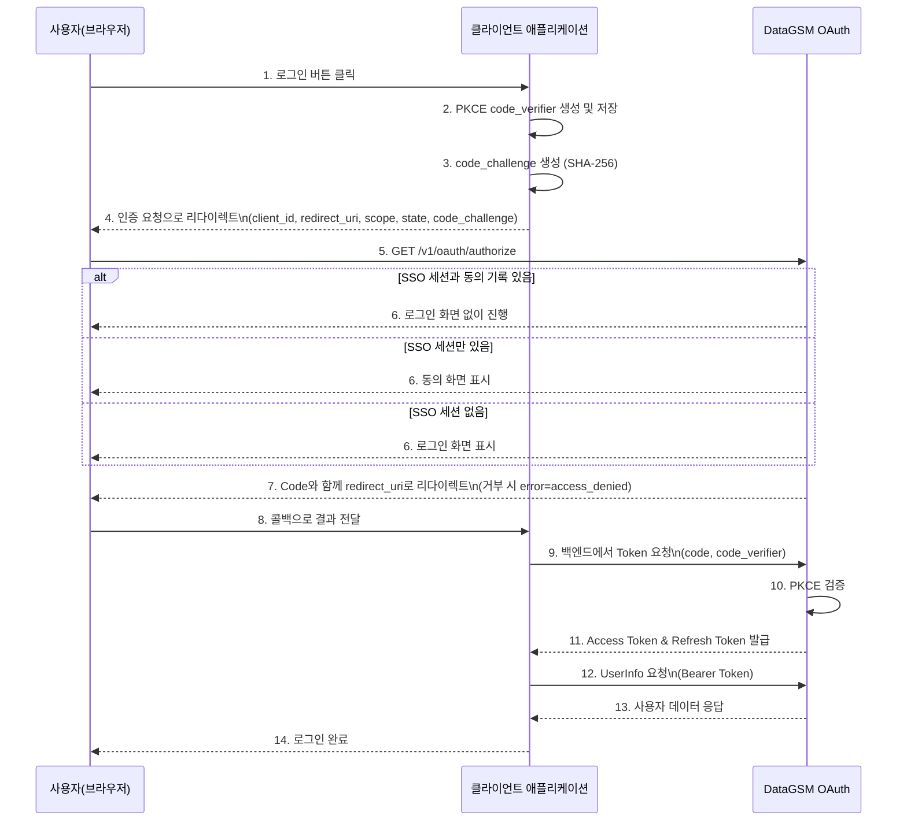

import { Shield } from 'lucide-react'

import { createDocsPageMetadata } from '@/shared/lib/metadata';

export const metadata = createDocsPageMetadata({ title: "OAuth", pathname: "/oauth" })

# OAuth

### 개요

DataGSM OAuth는 OAuth 2.0 Authorization Code Grant 플로우와 OpenID Connect를 지원하는 인증 시스템입니다. 사용자는 DataGSM 계정으로 서드파티 애플리케이션에 안전하게 로그인할 수 있으며, 애플리케이션은 사용자의 동의 하에 사용자 데이터에 접근할 수 있습니다. OAuth 2.0은 업계 표준 인증 프로토콜로, 사용자 비밀번호를 직접 공유하지 않고도 안전하게 리소스 접근 권한을 부여할 수 있습니다.

<div className="border-l-4 border-blue-500 bg-blue-50 dark:bg-blue-900/20 p-4 rounded my-6">
  <div className="flex items-start gap-3">
    <Shield className="h-5 w-5 text-blue-600 dark:text-blue-500 shrink-0 mt-0.5" />
    <div>
      <div className="font-semibold text-blue-900 dark:text-blue-100 mb-1">
        PKCE 사용 권장
      </div>
      <div className="text-blue-800 dark:text-blue-200 text-sm">
        PKCE (Proof Key for Code Exchange)는 공개 클라이언트와 기밀 클라이언트 모두에 권장합니다.
        <code className="mx-1 px-1.5 py-0.5 bg-blue-100 dark:bg-blue-800 rounded">client_secret</code>은 백엔드가 있는 기밀 클라이언트의 정식 인증 방식이며, PKCE와 함께 사용할 수 있습니다.
        자세한 내용은 <a href="/oauth/pkce" className="underline font-medium">PKCE 가이드</a>를 참고하세요.
      </div>
    </div>
  </div>
</div>

### PKCE 사용 이유

PKCE (Proof Key for Code Exchange, RFC 7636)는 OAuth 2.0의 보안 확장 표준입니다. `client_secret`은 백엔드에 안전하게 보관할 수 있는 기밀 클라이언트의 정식 인증 수단이지만, 다음 상황은 시크릿만으로 해결되지 않습니다:

- **시크릿을 보관할 수 없는 환경**: 브라우저나 모바일 앱에 포함된 값은 노출됨
- **Authorization Code 탈취**: 리다이렉트 과정에서 코드가 노출될 수 있음

PKCE는 인가 요청마다 **동적으로 생성되는 일회성 검증자**(`code_verifier`)를 추가합니다. 각 인증 요청마다 새로운 `code_verifier`를 생성하므로, Authorization Code를 탈취하더라도 원본 `code_verifier` 없이는 토큰 교환이 불가능합니다.

### 주요 특징

| 특징            | 설명                                                                      |
|---------------|-------------------------------------------------------------------------|
| **JWT 기반 토큰** | Access Token, Refresh Token, ID Token은 RS256으로 서명된 JWT이며 공개 키로 서명을 검증할 수 있습니다. |
| **PKCE 지원**   | Authorization Code 탈취 방지를 위해 PKCE (RFC 7636) 표준을 지원합니다.                 |
| **Redis 캐싱**  | Redis를 활용하여 토큰 데이터를 캐싱하고 빠른 검증을 제공합니다.                                  |
| **토큰 유효기간**   | Access Token 1시간, Refresh Token 30일, Authorization Code 5분의 유효기간을 가집니다. |
| **SSO**         | 로그인하면 8시간 동안 SSO 세션이 유지되어, 동의한 범위는 로그인 화면 없이 인가됩니다.     |
| **OpenID Connect** | Discovery와 `id_token`을 제공하여 표준 라이브러리로 연동할 수 있습니다. [OIDC 가이드](/oauth/oidc) |
| **요청 한도**     | OAuth 클라이언트 기준 분당 300회, 로그인 계정 기준 10분 10회입니다. 초과 시 `429`로 응답합니다. |
| **보안 강화**     | HTTPS 필수, Client Secret 기반 인증, State 파라미터를 통한 CSRF 방지를 지원합니다.           |
| **표준 준수**     | OAuth 2.0 RFC 6749, PKCE RFC 7636, OpenID Connect 표준을 따릅니다.                 |
| **서드파티 권한 범위** | DataGSM OAuth를 통해 외부 앱의 권한을 사용할 수 있습니다. |

### 시스템 요구사항

| 항목            | 요구사항                                      |
|---------------|-------------------------------------------|
| **프로토콜**      | HTTPS 필수 (개발 환경 제외)                       |
| **리다이렉트 URI** | 사전 등록된 리다이렉트 URI만 허용                      |
| **Client 등록** | DataGSM에서 Client ID 및 Client Secret 발급 필요 |

### 기본 개념

#### Authorization Code

사용자 로그인 성공 시 발급되는 일회성 코드입니다. Access Token으로 교환되며, **5분의 유효기간**을 가집니다.

#### Access Token

사용자 리소스에 접근하기 위한 JWT 토큰입니다. **1시간의 유효기간**을 가지며, API 요청 시 `Authorization: Bearer` 헤더에 포함하여 사용합니다.

#### Refresh Token

Access Token 만료 시 새로운 Access Token을 발급받기 위한 토큰입니다. **30일의 유효기간**을 가집니다.

#### Client Credentials

- **Client ID**: 애플리케이션을 식별하는 공개 식별자 (프론트엔드 사용 가능)
- **Client Secret**: 백엔드가 있는 기밀 클라이언트를 인증하는 비밀 키. 백엔드에만 보관

### 기본 권한 범위

권한 범위는 `{applicationId}:{scopeName}` 형식이며, DataGSM 기본 권한 범위의 Application ID는 `datagsm`입니다. 프로토콜 지시자인 `openid`만 접두어가 없습니다.

| 권한 범위 | 의미 |
|---|---|
| `datagsm:account_read` | [사용자 데이터 조회](/oauth/http/userinfo) 호출 권한, 계정 기본 정보 |
| `datagsm:student_read` | 학생, 선생님 상세 데이터 |
| `datagsm:club_read` | 소속 동아리. 명시해야 부여됩니다 |
| `datagsm:project_read` | 참여 프로젝트. 명시해야 부여됩니다 |
| `openid` | `id_token` 발급 |

OAuth 인증 요청에서는 필요한 `scope`를 **명시**하세요. 값은 클라이언트에 등록된 권한 범위여야 하며, 등록되지 않은 값이 포함되면 `400 invalid_scope`로 거부됩니다.

`datagsm:self_read`는 Deprecated입니다. 제거 일정은 미정이며, 전환 방법을 포함한 자세한 내용은 [권한 범위](/oauth/scopes)를 참고하세요. 자체 권한 범위를 정의하려면 [서드파티 권한 범위](/oauth/thirdparty-scope)를 참고하세요.

### 인증 플로우

DataGSM OAuth의 Authorization Code Grant 플로우는 다음과 같이 동작합니다.



인증 플로우는 다음 단계로 진행됩니다:

1. 사용자가 로그인 버튼 클릭
2. 클라이언트가 PKCE `code_verifier` 생성 및 저장 (43-128자 랜덤 문자열)
3. `code_verifier`를 SHA-256 해싱하여 `code_challenge` 생성
4. OAuth 서버로 인증 요청 (client_id, redirect_uri, scope, state, code_challenge 포함)
5. SSO 세션과 동의 기록에 따라 로그인 화면, 동의 화면, 코드 발급 중 하나로 진행
6. 인가가 끝나면 Authorization Code와 함께 `redirect_uri`로 리다이렉트. 사용자가 거부하면 `error=access_denied`가 전달됨
7. 클라이언트의 백엔드가 Token 교환 요청 (code, code_verifier 포함)
8. OAuth 서버가 PKCE 검증 (code_verifier 해싱 후 code_challenge와 비교)
9. 검증 성공 시 Access Token 및 Refresh Token 발급
10. Access Token으로 사용자 데이터 요청 및 로그인 완료

사용자 없이 서버 간 호출에 쓸 토큰이 필요하면 [Client Credentials](/oauth/http/client-credentials)를 사용합니다.

### 보안 가이드라인

OAuth 인증을 안전하게 구현하기 위한 주요 가이드라인입니다.

#### HTTPS 필수

모든 OAuth 통신은 **반드시 HTTPS**를 사용해야 합니다. HTTP는 토큰 탈취 위험이 있으므로 프로덕션 환경에서 사용 금지입니다. (개발 환경 localhost 예외)

#### PKCE 방식

PKCE는 Authorization Code 탈취 공격을 방지합니다. 다음 사항을 지켜 주세요:

- **code_verifier 생성**: 43-128자의 안전한 랜덤 문자열 생성 (암호학적으로 안전한 난수 생성기 사용)
- **code_challenge_method**: 항상 `S256` (SHA-256) 사용. `plain`은 호환용으로만 수용되며 제거 일정은 미정입니다
- **안전한 저장**: `code_verifier`는 httpOnly 쿠키나 서버 세션에 저장 (localStorage/sessionStorage 지양)
- **일회성 사용**: 각 인증 요청마다 새로운 `code_verifier` 생성
- **토큰 교환 위치**: 인가 서버의 CORS 허용 출처는 자사 서비스로 제한되므로 토큰 교환은 앱의 백엔드가 수행

자세한 구현 방법은 [PKCE 가이드](/oauth/pkce)를 참고하세요.

#### State 파라미터

CSRF 공격 방지를 위해 `state` 파라미터를 사용하세요. 랜덤 문자열을 생성하여 요청 시 전송하고, 콜백에서 검증합니다.

```javascript
// State 생성 및 저장
const state = crypto.randomUUID();
sessionStorage.setItem('oauth_state', state);

// 인증 요청 시 포함
const params = new URLSearchParams({
  client_id: clientId,
  redirect_uri: redirectUri,
  response_type: 'code',
  scope: 'datagsm:account_read datagsm:student_read',
  state,
});
window.location.href = `https://oauth.authorization.datagsm.kr/v1/oauth/authorize?${params}`;

// 콜백에서 검증
const urlParams = new URLSearchParams(window.location.search);
const returnedState = urlParams.get('state');
const savedState = sessionStorage.getItem('oauth_state');

// 검증 후 state 삭제
sessionStorage.removeItem('oauth_state');

if (!returnedState || returnedState !== savedState) {
  throw new Error('State mismatch - possible CSRF attack');
}

// 사용자가 동의를 거부하면 code가 없습니다.
if (urlParams.get('error') === 'access_denied') {
  showMessage('로그인을 취소했습니다.');
}
```

#### 토큰 저장

Access Token은 메모리나 sessionStorage에, Refresh Token은 서버 측 세션이나 HttpOnly 쿠키에 저장하세요. localStorage는 XSS 공격에 취약하므로 사용을 지양합니다.

### 기밀 클라이언트 (client_secret)

`client_secret`은 백엔드가 있는 기밀 클라이언트의 정식 인증 방식입니다. 본문 파라미터와 HTTP Basic 헤더를 모두 지원하며, PKCE와 함께 사용할 수 있습니다. PKCE 없이 발급된 코드를 교환할 때는 필수입니다.

`client_secret`을 사용할 때는 다음 사항을 반드시 준수하세요:

- **절대 프론트엔드 코드에 포함하거나 공개 저장소에 커밋하지 마세요**
- 백엔드의 환경 변수나 보안 볼트에 안전하게 저장
- 주기적으로 로테이션

### 시작하기

DataGSM OAuth를 사용하는 방법입니다.

#### PKCE 가이드 (권장)

PKCE를 사용한 안전한 OAuth 구현 방법을 배웁니다. 신규 애플리케이션은 여기서 시작하세요. [PKCE 가이드](/oauth/pkce)

#### 권한 범위

요청할 scope와 응답 범위를 확인하고, `self_read`를 쓰고 있다면 전환합니다. [권한 범위](/oauth/scopes), [변경 사항 및 마이그레이션](/migration)

#### OIDC

표준 라이브러리를 issuer 설정만으로 연동합니다. [OIDC 가이드](/oauth/oidc)

#### HTTP API

REST API를 직접 호출하여 구현합니다. 가장 유연하지만 구현 복잡도가 높습니다. [HTTP API 기술 문서](/oauth/http), [인증 흐름 시작](/oauth/http/authorize), [토큰 교환](/oauth/http/token-exchange), [토큰 갱신](/oauth/http/token-refresh), [Client Credentials](/oauth/http/client-credentials), [사용자 데이터 조회](/oauth/http/userinfo)

#### SDK

공식 SDK를 사용하면 OAuth 플로우를 간단하게 구현할 수 있습니다. [React SDK](/oauth/sdk/react), [Java/Kotlin SDK](/oauth/sdk/java)

Go 백엔드는 [Go 파트너 SDK](/oauth/sdk/go)를 사용할 수 있습니다.

#### 실전 예제

프레임워크별 완전한 구현 예제를 제공합니다. [React + Spring Boot (Kotlin)](/oauth/examples/react-spring-boot-kotlin)

### API 엔드포인트

#### OAuth 인증 서버 (Base URL)
`https://oauth.authorization.datagsm.kr`

#### 사용자 데이터 서버 (Base URL)
`https://oauth.resource.datagsm.kr`

#### OIDC Discovery
`https://oauth.authorization.datagsm.kr/.well-known/openid-configuration`

### 지원

OAuth 관련 문의는 GitHub Issues를 이용하세요. [DataGSM Front Issues](https://github.com/themoment-team/datagsm-front/issues), [DataGSM Server Issues](https://github.com/themoment-team/datagsm-server/issues)
